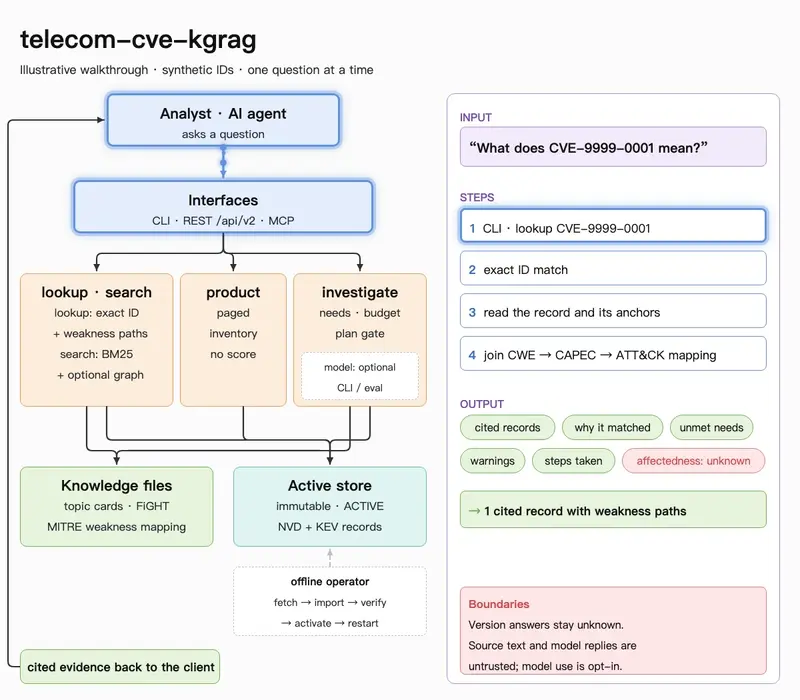

# VulnWitness

An evidence-backed vulnerability investigation workbench for analysts and AI agents.

The general evidence core covers CVE/KEV records, product queries, CWE → CAPEC → ATT&CK
catalogue associations, and sessions over synthetic fixtures or operator-imported data.
A built-in telecom extension adds topic cards and MITRE FiGHT threat context.
Catalogue associations are not attack paths or evidence of exploitation. Product
matches and NVD version notes leave affectedness `unknown`.



See [Architecture](docs/architecture.md) for behaviour and trust boundaries.

| Question | Service | What comes back |
|---|---|---|
| "What does this CVE mean?" | lookup / search | Source-backed records; lookup adds weakness paths |
| "Which CVEs mention Open5GS?" | product | Paged matches, product fields kept apart from description mentions |
| "What vulnerabilities and threats relate to GTP?" | investigate | Implementation CVEs, separate FiGHT context, unmet needs and the steps taken |
| "Does this affect my deployed version?" | product with a version | NVD version notes; verified affectedness stays `unknown` |

## Install

Requires Python 3.11+ and [uv](https://docs.astral.sh/uv/).
From a checkout (`uv` can install Python if needed):

```sh
uv sync --locked
source .venv/bin/activate
```

## Quick start

With `VULNWITNESS_STORE_ROOT` unset, these use the packaged synthetic fixture:

```sh
vulnwitness demo
vulnwitness lookup CVE-9999-0001
vulnwitness investigate 5G-AKA --scope mixed --format text
```

`investigate` exits 1 when needs remain unmet, including this pending-card example.

## Real data

Create a store root outside the repository, then fetch, import and activate:

```sh
mkdir -p ~/data/vulnwitness/stores
export VULNWITNESS_STORE_ROOT="$HOME/data/vulnwitness/stores"
.venv/bin/python scripts/operator/refresh_store.py --feeds-dir ~/data/vulnwitness/feeds/2026-10-31 --store nvd-2026-10-31 --activate
export VULNWITNESS_HTTP_TOKEN="$(python -c 'import secrets; print(secrets.token_urlsafe(32))')"
vulnwitness api
```

The bundled demo requires no corpus download. For the full NVD corpus, we recommend a
machine with 16 GB RAM or more; the minimum has not been established. Initial setup
involves a substantial download and several GB of disk space.
Keep the server running for repeated queries. Restart after activation or rollback.
The [runbook](docs/runbook.md) covers local-feed reuse, sizing and recovery.

## Entry points

- CLI lookup: `vulnwitness lookup CVE-9999-0001 --format text` — exact record and weakness
  paths; JSON is the default.
- CLI search: `vulnwitness search "authentication bypass" --format text` — ranked word
  matches; JSON is the default.
- CLI product: `vulnwitness product --vendor democorp --version 2.0 --format text` — counted
  inventory pages. With JSON output, `--all` prints every page;
  `--output FILE --export jsonl|csv` exports every page without requiring `--all`.
- CLI investigate: `vulnwitness investigate 5G-AKA --scope mixed --format text` — bounded evidence set.
- CLI capabilities: `vulnwitness capabilities` — sources, coverage and available tools.
- REST: `curl -H "Authorization: Bearer $VULNWITNESS_HTTP_TOKEN" http://127.0.0.1:8766/api/v2/capabilities`.
- MCP: `vulnwitness mcp` (stdio), or `vulnwitness mcp --http` (authenticated `/mcp` on port 8765).

Record data calls with `--session DIR` and JSON output; `--format text` is refused.
Product traversals and exports record each page as a separate call, subject to the
session call limit. Export files are outside the session record. See
[recording and checking sessions](docs/runbook.md#record-and-check-a-session).

## Share a report

Run `vulnwitness report DIR --format html --output DIR/report.html` to share a
self-contained session report, or use `--format md` for Markdown (the default).
Reports always run the session check and use only recorded content. They show the
separate check layers and flag contradicted or unverifiable claims; narrative support
is not checked. Omit `--output` to print to stdout; `--force` permits replacement.

## Use with an AI agent

Give your agent the [investigation Skill](skills/vulnwitness-investigation/SKILL.md)
for product triage, CVE lookup, and telecom questions with cited findings.
Use the [MCP configuration snippets](skills/vulnwitness-investigation/mcp-config/README.md)
for Claude Code, Codex, or Cursor; the plain stdio variants serve packaged demo data.
Launch `vulnwitness mcp --session DIR` to record tool calls and exact responses,
including failures. The agent authors `DIR/findings.yaml` separately, then runs
`vulnwitness session check DIR`. A passing check validates record consistency and
citation resolution; it does not establish that statements are supported by evidence.

## Limits

- Word matches and pending-review topic cards cannot establish sufficiency; normal
  runs with such matches end `needs_unmet`. Read matched terms and warnings.
- The GTP card covers the family; a GTP-U query can include GTP-C records.
- NVD may lack product/version data. A missing match or `no_hit` never establishes safety.
- No verified affectedness source is available. Weakness paths are derived catalogue associations.
- REST/MCP investigations are deterministic. Model planning is opt-in through the CLI;
  imported stores have no bound semantic collection.
- Results and context are bounded; an answer makes no completeness guarantee.

[Runbook](docs/runbook.md) · [Architecture](docs/architecture.md) ·
[Evaluation](docs/evaluation.md) · [Third-party data](THIRD_PARTY_DATA.md)

Pre-release contracts: [schema manifest](schemas/v2/manifest.json).
Code: [MIT](LICENSE); third-party data: [THIRD_PARTY_DATA.md](THIRD_PARTY_DATA.md).
