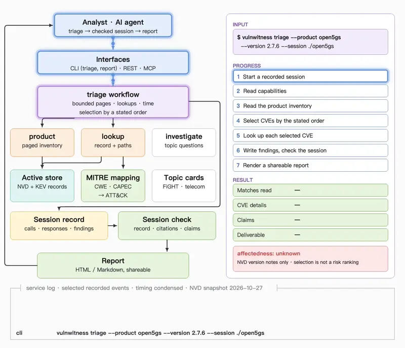
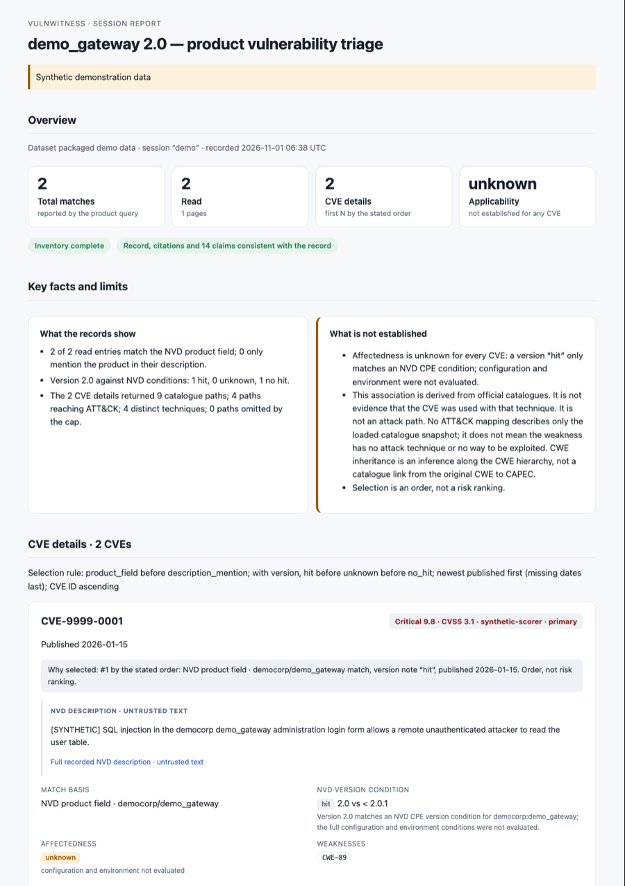
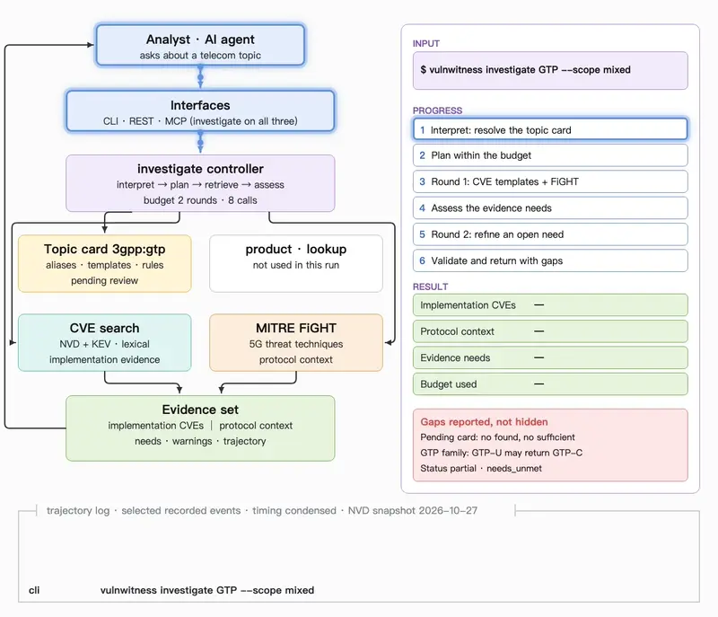

# VulnWitness

An evidence-backed vulnerability investigation workbench for analysts and AI agents.

VulnWitness answers vulnerability questions with cited, recorded evidence and says plainly
what it cannot establish. Its general core covers CVE/KEV records, product queries,
CWE → CAPEC → ATT&CK catalogue associations, recorded sessions, checks and reports. A
built-in telecom extension adds topic cards and MITRE FiGHT threat context.



*A real triage of Open5GS 2.7.6 on the NVD snapshot of 2026-10-27: selected recorded events,
timing condensed.*

## Three ways to use it

- **Command line.** `triage` runs a bounded product investigation and records every call;
  `report` turns any recorded session into a shareable HTML or Markdown report. Individual
  commands (`lookup`, `search`, `product`, `investigate`) return JSON or readable text.
- **Claude Code plugin and MCP agents.** Local test: `claude --plugin-dir plugins/vulnwitness`
  (tested with Claude Code 2.1.316). It needs a checkout set up with `uv sync --locked`
  and `VULNWITNESS_BIN` pointing at its `vulnwitness`; see the
  [plugin runbook](docs/runbook.md#claude-code-plugin). Other clients have no hook.
  For direct MCP, `vulnwitness mcp --workspace ~/.vulnwitness/workspace` lets
  an agent triage a product, inspect recorded evidence, add findings and deliver a checked
  report without a shell. The [investigation Skill](plugins/vulnwitness/skills/vulnwitness-investigation/SKILL.md)
  guides the flow; [client snippets](plugins/vulnwitness/skills/vulnwitness-investigation/mcp-config/README.md)
  for Claude Code, Codex and Cursor follow their documented formats and have not yet been
  tested inside those clients.
- **Local browser UI.** `vulnwitness ui --workspace ~/.vulnwitness/workspace` opens a local
  evidence workspace for product triage, CVE lookup and telecom topics. Install the `api`
  extra, open the printed URL, continue investigations, check them and export HTML reports.
  Reports show record consistency, citation resolution, structured claims and unchecked
  narrative separately. See the [UI runbook](docs/runbook.md#local-browser-ui).

## Two-minute quick start

Requires Python 3.11+ and [uv](https://docs.astral.sh/uv/). With `VULNWITNESS_STORE_ROOT`
unset, everything runs on packaged synthetic demo data:

```sh
uv sync --locked
source .venv/bin/activate
vulnwitness triage --vendor democorp --product demo_gateway --version 2.0 --session ./demo
vulnwitness report ./demo --format html --output ./demo-report.html
```

[](docs/media/report-demo.png)

*Synthetic demo data. The report opens with what was read, what was looked up and what is
not established, followed by one card per CVE.*

`triage` exits `0` when the planned scope completes and the checks pass, `1` when nothing
matches, `2` on failure, and `3` when a page or time cap stopped it early with results
saved and checks passing. Use a new directory for each run.

## Topic investigations

Topic cards connect a domain question such as "GTP" or "5G-AKA" to concrete retrieval: aliases,
search templates, relevance rules and exclusions. `investigate` resolves the card, searches
implementation CVEs and FiGHT protocol threats within a fixed budget, keeps the two kinds of
evidence apart, and reports which evidence needs remain open.



*A real `vulnwitness investigate GTP --scope mixed` on the NVD snapshot of 2026-10-27: selected
trajectory events, timing condensed.* The bundled GTP and 5G-AKA cards are pending review, so
they return candidates but never establish `found` or `sufficient`. GTP is matched as a
family: a GTP-U question can return GTP-C records.

| Question | Command | What comes back |
|---|---|---|
| "What does this CVE mean?" | `lookup` / `search` | Source-backed records; lookup adds weakness paths |
| "Which CVEs are recorded for Open5GS?" | `triage` → `report` | The match inventory read within its caps, a deeper look at selected CVEs, and a report |
| "What vulnerabilities and threats relate to GTP?" | `investigate` | Implementation CVEs, separate FiGHT context, open needs and the steps taken |
| "Does this affect my deployed version?" | `product --version` | NVD version notes; verified affectedness stays `unknown` |

## Real data

Create a store root outside the repository, then fetch, import and activate:

```sh
mkdir -p ~/data/vulnwitness/stores
export VULNWITNESS_STORE_ROOT="$HOME/data/vulnwitness/stores"
.venv/bin/python scripts/operator/refresh_store.py --feeds-dir ~/data/vulnwitness/feeds/2026-10-31 --store nvd-2026-10-31 --activate
```

For the full NVD corpus, we recommend a machine with 16 GB RAM or more; the minimum has not
been established. Initial setup involves a substantial download and several GB of disk space.
The [runbook](docs/runbook.md) covers fetching, local-feed reuse, FiGHT and MITRE snapshots,
servers, sizing and recovery.

## Reference

- `vulnwitness lookup CVE-9999-0001 --format text`: exact record and weakness paths.
- `vulnwitness search "authentication bypass" --format text`: ranked word matches.
- `vulnwitness product --vendor democorp --version 2.0 --format text`: counted inventory pages;
  `--all` prints every page, and `--output FILE --export jsonl|csv` exports them.
- `vulnwitness investigate 5G-AKA --scope mixed --format text`: a bounded evidence set.
- `vulnwitness triage … --session DIR` and `vulnwitness report DIR`: see the
  [triage runbook](docs/runbook.md#one-command-product-triage).
- `--session DIR` records individual data calls (JSON output only), and
  `vulnwitness session check DIR` checks a session: see
  [recording and checking sessions](docs/runbook.md#record-and-check-a-session).
- REST: `vulnwitness api` with `VULNWITNESS_HTTP_TOKEN`, then
  `curl -H "Authorization: Bearer $VULNWITNESS_HTTP_TOKEN" http://127.0.0.1:8766/api/v2/capabilities`.
- MCP: `vulnwitness mcp` (stdio), or `vulnwitness mcp --http` (authenticated `/mcp` on port 8765).

## Limits

- Word matches and pending-review topic cards cannot establish sufficiency; an otherwise
  completed run with such matches ends `needs_unmet`, while budget or source failures can
  set another stop reason. Read matched terms and warnings.
- NVD may lack product or version data. A missing match or `no_hit` never establishes safety.
- No verified affectedness source is available. Weakness paths are derived catalogue
  associations, not attack paths, and "no ATT&CK mapping" describes the loaded snapshot only.
- Triage selection is an order, not a risk ranking.
- REST and MCP investigations are deterministic. Model planning is opt-in through the CLI;
  imported stores have no bound semantic collection.
- Results and context are bounded; no answer guarantees completeness.

[Runbook](docs/runbook.md) · [Architecture](docs/architecture.md) ·
[Evaluation](docs/evaluation.md) · [Third-party data](THIRD_PARTY_DATA.md)

Pre-release contracts: [schema manifest](schemas/v2/manifest.json).
Code: [MIT](LICENSE); third-party data: [THIRD_PARTY_DATA.md](THIRD_PARTY_DATA.md).
